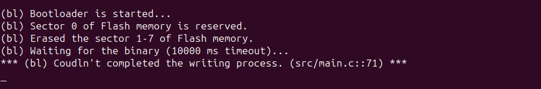
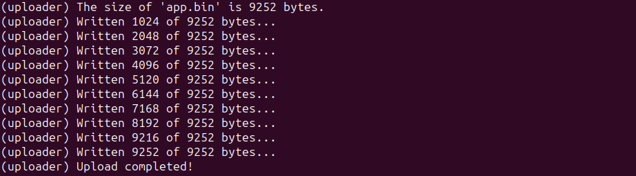
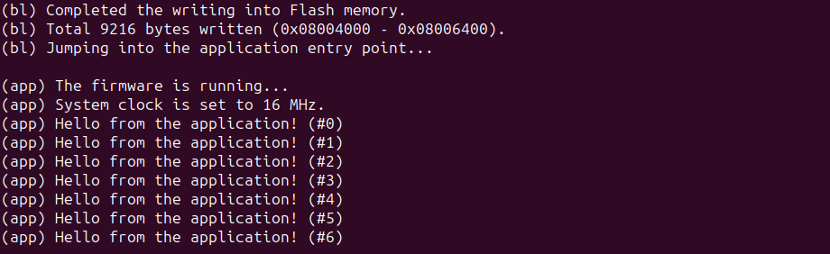

# Bootloader for STM32F446RE

This repo demonstrates that how to implement a bootloader for STM32F446RE, an example 
application that will be loaded by the bootloader and a uploader program to upload the
application. So it can be divided into three parts:

+ `Bootloader`
+ `Application`
+ `Uploader`

I've used the STM32F446RE-based Nucleo board in here. Of course, you can use any other
board, but it MUST be STM32F4x-based at least. If you look at the source files, I have
used `USART2` peripheral for transmitting/receiving stuffs. You can change it
according to your requirements.

You can look at the `docs/bootloader.txt` to read the bootloader properties or 
technical details. In here, I want to explain the practical implementation details.

## Bootloader-Side

Bootloader is like a normal embedded firmware, but doing some unique stuffs:

+ Erase/program the required sections of Flash memory.
+ Set the `MSP` (Main Stack Pointer) and `VTOR` (Vector Table Offset Register) for the 
  coming the application binary.
+ Lastly, jump into the application's entrt point (its `main()`).

As you will see in `docs/bootloader.txt`, I selected the first section (Section 0) of
Flash memory for bootloader and later sections (Section 1-7) for the application. As
you probably know, the memory layout of the firmware is determined by the linker script.
In `drivers/bl_linker.ld`, it is set by line 20-24. There is also `drivers/bl_system.c`
that defines the VTOR (the address of the vector table location) address in line 183-185.
The first word of the vector table is set the initial MSP and the second word is set to
reset handler which is the key function to jump the application's entry point.

The implementation of the bootloade is under `src`. If you look at there, you will see
that it erases the application's Flash memory area and then try to receives the 
application firmware. If it succeeds, it writes the application into the Flash memory.
Lastly, it jumps to the application's `main()`. If you zoom in the jumping logic, I
explicitly set the MSP and VTOR to the new values. This is the most important part. At
startup, the Cortex-M set these to `0x08000000` address. But in here, I want to put the
bootloader there and then put the application after that (`0x08004000` in case). 

Below is the build recipies of the bootloader-side:

```shell
$ make bl-lib
$ make bl-bin
```

After these commands, the output artifacts will be `lib/libbl.a`, `bin/bl.elf`, `bin/bl.bin`,
`bin/bl.map`. In here, `bin/bl.elf` is passed to the microcontroller. I generally use the
`openocd` to flash the firmware like this:

```shell
$ openocd -f interface/stlink.cfg -f target/stm32f4x.cfg -c "program bin/bl.elf verify reset exit"
```

If you immediatelly want to see the bootloader outputs, `screen` can be used to monitor the
attached port:

```shell
$ screen /dev/ttyACM0 115200
```

The output will be:



As you see, the bootloader tried to receive the application binary, but it failed. Because,
the bootloader is passive listener. An additional program should give the application to
the bootloader. I named it as `uploader` program. I will explain it later. 

## Application-Side

As I stated before, the application firmware will reside in the Flash memory (at `0x08004000`) 
after the bootloader. Because of changed the vector table relocation here, I also need a
linker script specific to application. It's `drivers/app_linker.ld`. Line 20-24 shows the
new location. I also explicitly declared the VTOR address in `drivers/app_system.c` by line
183-185. 

The application code is simply a while loop and priting some strings. In here, there is no
importance of the application code. I just need to see the jumping logic from the bootloader
to the application.

The build recipies:

```shell
$ app bl-lib
$ app bl-bin
```

After these commands, the output artifacts will be `lib/libapp.a`, `bin/app.elf`, `bin/app.bin`,
`bin/app.map`. There is a important point here, the bootloader needs to receive the raw binaries
of the application. So `bin/app.bin` shoud be given. As you know `bin/app.elf` includes the all
metadata/debug stuffs besides the raw machine code.

But How exactly shoud `bin/app.bin` be given to the bootloader?

## Uploader-Side

I also need a specific program that runs in the host machine and gives the application binaries
to the bootloader. Don't forget: the both bootloader and application programs will run in the
embedded processor. I located the uploader program under `utility`. The design of it is highly
depended to the communication protocol. The uploader program set the (serial) port attributes
firstly. After that the application binary coming from the command-line is read and then raw
bytes are written directy to the communication port. That's it!

If you look at the my bootloader design, I simply used the timeout-based receiving protocol. Of 
course, this is the simplest design probably. In production-grade software, some kind of header
is sent including acknowledge sign, binary size or so on. So the bootloader can know that how
many bytes exactly should be received. 

In my design, I just set the timeout and expect the uploader program transmit the application
binaries before the timed out!

To build the uploader program, following command is used.

```shell
$ make uploader
```

The output artifact will be `bin/uploader`.

After flashed the bootloader firmware via `openocd`, run the uploader after 5-10 seconds:

```shell
$ $ ./uploader /dev/ttyACM0 bin/app.bin
```

The uploader output will be:



After that if you monitor the serial line with `screen` or similar tools, you will see the 
jumping from the bootloader to the application:



After this point, the bootloader gives the execution of the processor to the application
completely. That's it! After reset, the bootloader will wait the application again.

## Renode Emulation

If you don't have any physical board, you can still see the how the bootloader works. But of
course, it is going to be limited. Anyway, I want show that how Renode is used. If you have
already embedded programming background, you probably heard it. If you don't, you can it like
`qemu`, but for embedded processors. 

Firstly, you should go to the official Renode GitHub page and then download the latest version
of it. After extracting the content of it, you will see many programs, libraries, and embedded
processor configuration files. You don't need any knowledege about that. I've already placed
two files under `renode`: `stm32f4.repl` and `stm32f4.desc`. `stm32f4.repl` is the official
file I moved from the Renode directory to here, while I've written `stm32f4.desc` file which
includes just a few commands for Renode program. According to your installed Renode directory,
run this command:

```shell
$ ~/Softwares/renode/renode renode/stm32f4.desc
```

This command will create a virtual machine on your host and then you can see the bootloader
outputs in there. But I don't know that how run uploader program from there to see the
jumping. I will look at there...